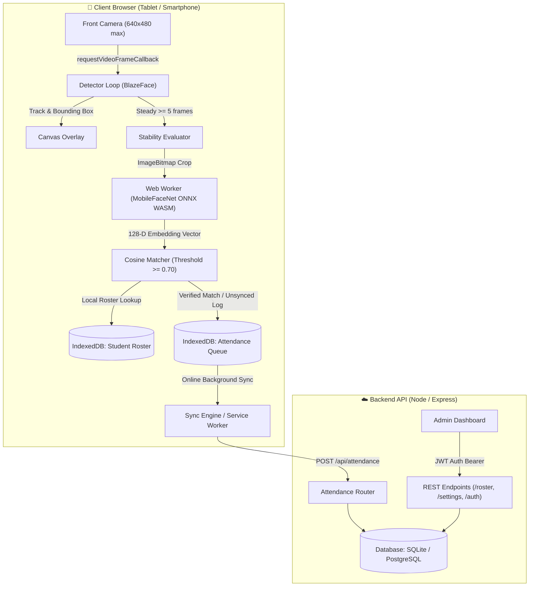

# 🛡️ Verity — Mobile-Web Classroom Face-Recognition Attendance System

A high-performance, offline-first mobile web application that captures front-facing video, runs **MediaPipe BlazeFace** detection on the main thread, delegates stable-face crops to a dedicated **Web Worker running MobileFaceNet** via ONNX Runtime Web (WASM-SIMD), matches against a local IndexedDB student roster, and logs verified attendance with background synchronization.

---

## 🏛️ System Architecture



---

## 🚀 Key Features

1. **Lightweight Edge Face Tracking**:
   - Camera manager clamps front-camera resolution to `640x480` to protect frame budgets.
   - Leverages `requestVideoFrameCallback` for frame-accurate processing synchronized with device displays.
   - Smooth corner-bracket bounding box overlay with dynamic status badges (`Acquiring...` vs `Stable (5/5)`).

2. **Web Worker Offloading**:
   - Zero UI thread blocking: face embedding extraction and similarity comparison run exclusively inside a dedicated Web Worker (`matcherWorker.js`).
   - Powered by ONNX Runtime Web with WASM-SIMD acceleration.

3. **Offline-First Resilience**:
   - Offline PWA caching via Service Worker (`service-worker.js`).
   - Student roster cached locally in IndexedDB (`idb`).
   - Attendance verification events queue in IndexedDB when offline and auto-sync to `/api/attendance` upon network reconnection.

4. **Multi-Tenant Administration**:
   - Institutional multi-tenancy with isolated rosters, admins, and attendance logs.
   - Batch CSV and JSON upload for student rosters.
   - Real-time date-based reporting with CSV export capabilities.

5. **Battery Saver & FPS Negotiation**:
   - Admin settings to toggle target FPS (`15`, `30`, `60`) and model quality (`low`, `medium`, `high`).
   - Dedicated battery-saver mode that forces maximum 30 FPS and economizes processor cycles on classroom tablets.

---

## 📦 Project Structure

```
Verity/
├── api.yaml                  # Complete OpenAPI 3.0 REST Specification
├── schema.sql                # PostgreSQL Production DDL Schema
├── docker-compose.yml        # Multi-container setup (Postgres + Backend + Frontend)
├── package.json              # Monorepo workspaces orchestrator
├── scripts/
│   └── benchmark.js          # Latency & frame-budget assertion benchmark
├── backend/
│   ├── Dockerfile
│   ├── prisma/
│   │   ├── schema.prisma     # Prisma ORM schema (SQLite dev / PostgreSQL prod)
│   │   └── seed.js           # Seed script (Admin, Tenant, Students with 128-D vectors)
│   ├── src/
│   │   ├── index.js          # Express app entry point & health check
│   │   ├── db.js             # Prisma client singleton
│   │   ├── middleware/auth.js# JWT token authentication
│   │   ├── routes/           # Auth, Tenant, Roster, Settings, Attendance, Metrics
│   │   └── utils/
│   │       └── CosineMatcher.js # Vector similarity calculation
│   └── tests/
│       └── matcher.test.js   # Unit test suite
└── frontend/
    ├── Dockerfile
    ├── vite.config.js        # Vite config with WASM cross-origin isolation headers
    ├── index.html
    └── src/
        ├── main.jsx          # React app entry point & SW registration
        ├── routes.jsx        # Protected and public route definitions
        ├── auth/auth.js      # JWT token management & Axios interceptors
        ├── components/       # DashboardLayout, Sidebar, Navbar
        ├── pages/            # Login, Dashboard, RosterPage, SettingsPage, AttendancePage, ReportsPage
        ├── vision/
        │   ├── cameraManager.js   # Front-camera acquisition & FPS clamping
        │   ├── detectorLoop.js    # BlazeFace tracking & stability evaluator (5 frames)
        │   ├── matcherWorker.js   # Web Worker running MobileFaceNet ONNX inference
        │   └── CosineMatcher.js   # Client vector cosine similarity matcher
        ├── storage/          # IndexedDB helpers for roster, queue, and settings
        └── sw/               # Service Worker & registration
```

---

## 🛠️ Quick Start

### Prerequisites
- Node.js >= 20.x
- npm >= 10.x
- (Optional) Docker & Docker Compose

### 1. Installation
Install all root, frontend, and backend dependencies:
```bash
npm install
```

### 2. Database Setup & Seeding
Initialize the SQLite database and seed demo data:
```bash
cd backend
npm run prisma:push
npm run prisma:seed
cd ..
```

> **Default Seed Credentials:**  
> **Email:** `admin@verity.edu`  
> **Password:** `admin123`  
> **Tenant:** St. Joseph's College Colombo 10

### 3. Run Development Servers
Start both backend (port 8080) and frontend (port 5173) concurrently:
```bash
npm run dev
```

Visit the application at [http://localhost:5173](http://localhost:5173).

---

## 🧪 Testing & Verification

### Run Unit Tests
```bash
npm test
```
Runs unit tests for `cosineSimilarity`, threshold assertions, and `findBestMatch` nearest-neighbor lookups.

### Run Performance Latency Benchmark
```bash
npm run test:benchmark
```
Benchmarks 1,000 face recognition lookups against a 500-student roster, asserting average latency `< 30ms` (typically completes in `< 0.2ms`).

---

## 🐳 Docker Deployment

To launch the complete containerized stack (PostgreSQL + Express Backend + Nginx Frontend):
```bash
docker compose up --build
```
- **Frontend Web UI**: [http://localhost](http://localhost)
- **Backend API**: [http://localhost:8080/api](http://localhost:8080/api)
- **Backend Health Check**: [http://localhost:8080/api/health](http://localhost:8080/api/health)
- **Prometheus Metrics**: [http://localhost:8080/metrics](http://localhost:8080/metrics)

---

## 📑 API Endpoints Summary

| Method | Endpoint | Description | Auth Required |
|--------|----------|-------------|---------------|
| `POST` | `/api/auth/login` | Authenticate admin, returns JWT & tenant ID | No |
| `POST` | `/api/auth/register` | Register new admin and provision school tenant | No |
| `POST` | `/api/tenant/create` | Provision an isolated school tenant | Bearer JWT |
| `GET` | `/api/roster` | Retrieve all students & 128-D embeddings | Bearer JWT |
| `POST` | `/api/roster/batch` | Batch insert/update students and embeddings | Bearer JWT |
| `PUT` | `/api/roster/:id` | Update individual student record | Bearer JWT |
| `DELETE` | `/api/roster/:id` | Delete student record | Bearer JWT |
| `GET` | `/api/settings` | Get tenant performance preferences | Bearer JWT |
| `PUT` | `/api/settings` | Save target FPS, model quality, and battery saver | Bearer JWT |
| `POST` | `/api/attendance` | Record verified attendance event | Bearer JWT |
| `GET` | `/api/attendance/report` | Fetch attendance logs & stats by date | Bearer JWT |
| `GET` | `/api/health` | Container health check | No |
| `GET` | `/metrics` | Prometheus telemetry exposition | No |

Complete request and response schemas are detailed in [`api.yaml`](file:///home/mana/Projects/Verity/api.yaml).
